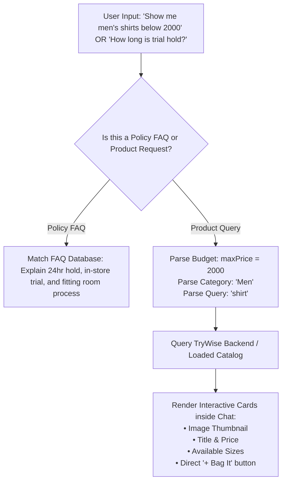

# 📋 TryWise — 4-Feature Implementation Plan & Architectural Roadmap

> **Document Scope:** Comprehensive implementation guide for Search in Products, Smart Shopping & FAQ Chatbot, Customer Requests Hybrid Tab, and Google OAuth on Render Free Tier.  
> **Priority Phase:** Features 1 and 2 to be implemented first.

---

## 📌 Executive Summary

| # | Feature | Status / Priority | Key Technical Highlights |
|---|---|---|---|
| **1** | **Product Search & Add to Cart** | 🟢 **Phase 1 (Immediate)** | Django `icontains` query filter, responsive search input + button, instant Enter key trigger, preservation of size selection & stock limits. |
| **2** | **Shopping & FAQ Chatbot** | 🟢 **Phase 1 (Immediate)** | Hybrid Chatbot (combines Quick FAQ chips with catalog budget/keyword search like *"under 2k"*), rendering interactive product cards with direct "+ Bag It" buttons. |
| **3** | **Customer Requests Tab (Hybrid)** | 🟡 **Phase 2** | Separate staging cart from active store trial bookings. Live countdown deadline & fitting room token on top, past trial history below. |
| **4** | **Google Login (Render Free Tier)** | 🟡 **Phase 2** | 100% compatible with Render Free Tier (standard HTTPS token exchange). Google Identity Services (GIS) on frontend + `google-auth` on Django backend. |

---

## 🔍 Feature 1: Product Search & Add to Cart

### 1. Current State vs. Target Architecture
* **Current State:** [`Products.jsx`](file:///d:/code/PyGen5/TryWise_React_Frontend/src/pages/Products.jsx) only filters by category buttons (`All`, `Women`, `Men`). The backend [`ProductListCreateView`](file:///d:/code/PyGen5/backend/serv/trywise/views.py) only receives `?category=...`.
* **Target State:**
  - A clean search bar with a search icon (`🔍`), clear button (`✕`), and a dedicated **"Search"** button.
  - Supports searching by product name, description keywords, or category.
  - Triggers on clicking the Search button or pressing the `Enter` key.
  - Search results display with full size selector (`S`, `M`, `L`, `XL`), urgency stock badges, and an operational **"+ Bag It"** button that increments the cart and triggers toast alerts.

### 2. Architectural Data Flow
```
[User enters search term & clicks Search]
                    │
                    ▼
[Products.jsx state: searchQuery = "denim"]
                    │
                    ▼
[fetchProducts(activeCategory, searchQuery)]
                    │
                    ▼
[GET /api/products/?category=All&search=denim]
                    │
                    ▼
[Django ORM: Q(name__icontains=search) | Q(category__icontains=search)]
                    │
                    ▼
[Return filtered products -> Render with Size Picker & "+ Bag It"]
```

### 3. Detailed File Modifications

#### A. Backend: `backend/serv/trywise/views.py`
Update `ProductListCreateView.get` to parse the `search` query parameter:
```python
from django.db.models import Q

class ProductListCreateView(APIView):
    def get(self, request):
        category = request.query_params.get('category', None)
        search = request.query_params.get('search', '').strip()

        products = Product.objects.all()

        # Category Filter
        if category and category.lower() != 'all':
            products = products.filter(category__iexact=category)

        # Search Keyword Filter
        if search:
            products = products.filter(
                Q(name__icontains=search) | Q(category__icontains=search)
            )

        serializer = ProductSerializer(products, many=True, context={'request': request})
        return Response(serializer.data, status=status.HTTP_200_OK)
```

#### B. Frontend Service: `TryWise_React_Frontend/src/services/api.js`
Update `fetchProducts` to accept the `search` argument:
```javascript
export async function fetchProducts(category = "All", search = "") {
  const cleanCat = category ? category.trim() : "All";
  const params = new URLSearchParams();

  if (cleanCat && cleanCat !== "All") {
    params.append("category", cleanCat);
  }
  if (search && search.trim()) {
    params.append("search", search.trim());
  }

  const queryString = params.toString();
  const url = queryString ? `${API_BASE_URL}/products/?${queryString}` : `${API_BASE_URL}/products/`;

  const response = await fetch(url, { method: "GET" });
  const resData = await response.json();
  if (!response.ok) {
    throw new Error(resData.detail || "Failed to fetch products.");
  }
  return resData;
}
```

#### C. Frontend UI: `TryWise_React_Frontend/src/pages/Products.jsx`
* Introduce state: `searchQuery` (typed text) and `appliedSearch` (active submitted filter).
* Add a search bar row above/next to the category filters:
  - Input field with placeholder: *"Search collection (e.g. linen shirt, floral dress)..."*
  - Clear button `✕` to reset search.
  - Primary button `Search 🔍`.
* Empty search result UI with a quick "Reset search" action button.
* Keep the existing size selection state (`selectedSizes`) and `addToCart` handler completely intact.

---

## 🤖 Feature 2: Chatbot Recommendation — Which Type is Better?

### 1. Comparative Analysis

| Dimension | Option A: Pure FAQ Bot | Option B: Pure LLM AI Bot | Option C: Hybrid Smart Shopping Assistant (Recommended) |
|---|---|---|---|
| **Mechanism** | Static predefined answers triggered by button clicks or keyword regex. | Standard prompt-response AI model. | Combines **Fast FAQ Action Chips** + **Dynamic Catalog Search Engine**. |
| **Product Search (e.g. "under 2k")** | ❌ Cannot search products dynamically. | ⚠️ May hallucinate products not actually in your inventory. | ✅ Intercepts queries, queries live inventory, and returns actual items under ₹2,000. |
| **Interactive Cards** | ❌ Text only. | ❌ Usually links or plain text. | ✅ **Mini product cards with direct "+ Bag It" buttons**. |
| **API Costs & Latency** | Free & instantaneous. | Pay-per-token API cost, latency. | **Zero cost** if using client/backend catalog filtering, or free-tier Gemini API. |
| **Verdict** | Too limited for e-commerce. | High risk of hallucinations. | ⭐ **Winner — Best UX and direct sales conversion**. |

---

### 2. How the Hybrid Shopping Assistant Operates



### 3. Key Capabilities of the Hybrid Chatbot
1. **Budget-Aware Product Finder:**
   - Detects queries such as:
     - *"Send me products below 2k"* / *"under 1500"*
     - *"Show me party wear for women"*
     - *"Do you have formal shirts for men?"*
   - Returns curated mini-cards directly in the chat with product photo, price tag, size tags, and a **"+ Bag It"** button.
2. **Instant FAQ Action Chips:**
   - One-tap buttons for common shopper inquiries:
     - 🛍 *"How does Bag It work?"*
     - ⏱️ *"How long do you hold clothes?"*
     - 💳 *"Do I pay online or in the store?"*
     - 📍 *"Store Hours & Location"*
3. **Implementation Approaches:**
   - **Approach 1 (Zero-Cost / Instant):** Client & Backend rule-based filter parsing. Requires no external AI API key, executes in under 50ms, and runs reliably forever.
   - **Approach 2 (AI-Powered):** Connect to Google Gemini API (Generative Language API free tier) using Function Calling to query the TryWise database and respond conversationally.

---

## 📦 Feature 3: Customer Requests Tab (Hybrid Approach)

### 1. Problem with Current Implementation
In the current design, customer orders are listed at the bottom of [`Cart.jsx`](file:///d:/code/PyGen5/TryWise_React_Frontend/src/pages/Cart.jsx). This causes confusion because:
- The cart is an **active staging area** (items selected but not yet booked).
- Submitted orders are **live store bookings** with hold deadlines and fitting room reservations.

### 2. Proposed Hybrid Architecture
Provide two distinct tabs for customers in the header and profile:
1. **"Bag It" (Active Cart):** Staging area where items are adjusted, sizes picked, and submitted.
2. **"My Requests / Trials" (Dedicated Tab):** A dedicated hybrid view split into two sections:

```
┌─────────────────────────────────────────────────────────────┐
│ 🟢 SECTION 1: ACTIVE IN-STORE RESERVATIONS                  │
│                                                             │
│ • Request #1042 — Status: "✨ Ready to Try On!"              │
│ • Hold Countdown: ⏰ 1 hr 45 mins left (Valid until 9:00 PM) │
│ • Fitting Room Token: Show code #1042 at Store Front Desk    │
│ • Reserved Items: Black Blazer (M), White Linen Shirt (L)   │
│ • [Cancel Request Button] (if customer cannot visit)        │
└─────────────────────────────────────────────────────────────┘
                               ▲
                               │
┌─────────────────────────────────────────────────────────────┐
│ ⚪ SECTION 2: TRIAL HISTORY & SUMMARY ARCHIVE               │
│                                                             │
│ • Request #1038 — Completed on Oct 24                       │
│   - Navy Chinos (Size 32) -> Purchased (₹1,899)            │
│   - Grey Polo (Size M) -> Restocked to Rack                 │
│ • Request #1012 — Expired (Trial window lapsed)             │
└─────────────────────────────────────────────────────────────┘
```

---

## 🔐 Feature 4: Google Login & Render Free Plan Compatibility

### 1. Can it be implemented on Render's Free Plan?
**Yes, absolutely.**
* Render's Free Tier provides 512 MB RAM and standard HTTP/HTTPS egress.
* Google Login uses standard OAuth 2.0 HTTPS calls to Google identity servers (`https://oauth2.googleapis.com` and `https://www.googleapis.com`).
* It does **not** require extra background workers, Redis, or dedicated server ports.

### 2. Implementation Flow (SPA Google Identity Services)
```
1. Customer clicks "Sign in with Google" in LoginModal.jsx
2. Google GIS One-Tap / Popup authenticates user and returns a signed ID Token (JWT).
3. Frontend sends ID Token to: POST /api/auth/google/
4. Django backend validates token signature with `google-auth` library:
   - Verifies issuer and audience (GOOGLE_CLIENT_ID).
   - Extracts email, first_name, last_name.
5. If user exists:
   - Issues TryWise JWT access & refresh tokens.
6. If user is new:
   - Creates customer account (role='customer', email_verified=True).
   - Issues TryWise JWT access & refresh tokens.
7. Customer is instantly logged in with zero password / OTP friction!
```

---

## 🚀 Execution Strategy & Next Steps

```mermaid
graph TD
    subgraph Step 1: Products Search
        A[Add ?search= to ProductListCreateView in Django]
        B[Update fetchProducts in api.js]
        C[Add Search Bar & Button in Products.jsx]
        D[Preserve Size Selector & '+ Bag It']
        A --> B --> C --> D
    end

    subgraph Step 2: Shopping & FAQ Chatbot
        E[Create Chatbot Component & Floating Launcher]
        F[Implement Hybrid Engine: FAQs + Budget/Keyword Search]
        G[Embed Interactive Product Cards with '+ Bag It']
        E --> F --> G
    end

    Step 1 --> Step 2
    Step 2 --> H[Proceed to Features 3 & 4: Requests Tab & Google Login]
```

### Next Action:
We will begin with **Feature 1 (Products Search & Add to Cart)**:
1. Update `backend/serv/trywise/views.py` with the `search` query filter.
2. Update `TryWise_React_Frontend/src/services/api.js` to send search parameters.
3. Update `TryWise_React_Frontend/src/pages/Products.jsx` with the Search Bar UI and button.

